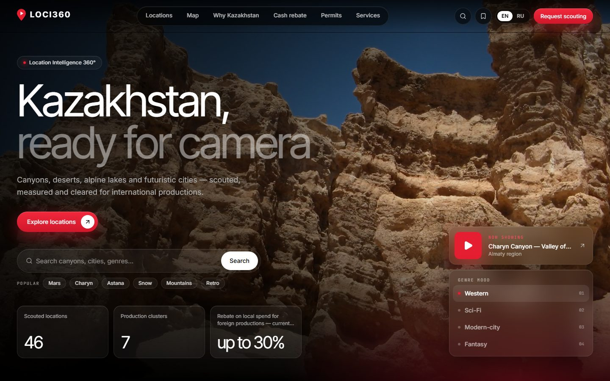
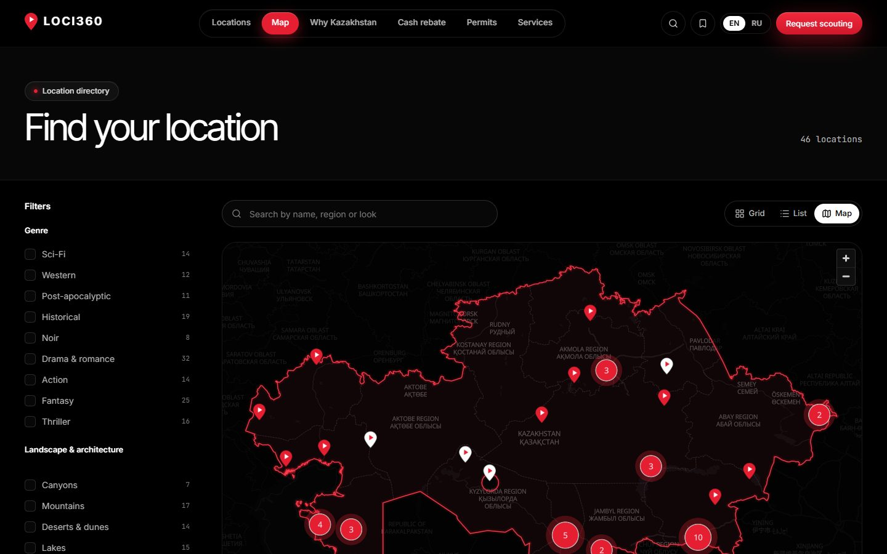
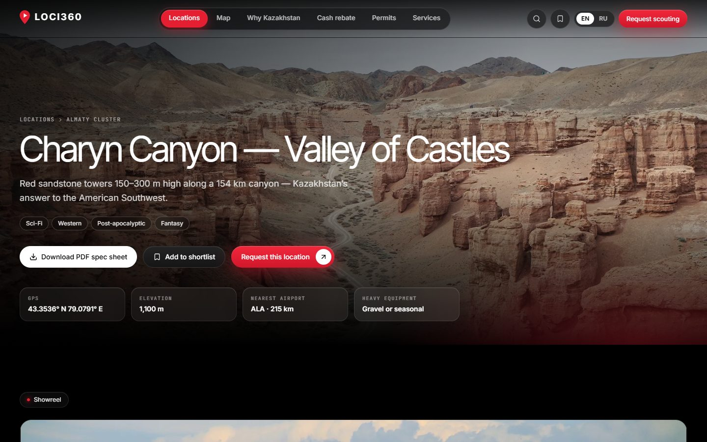
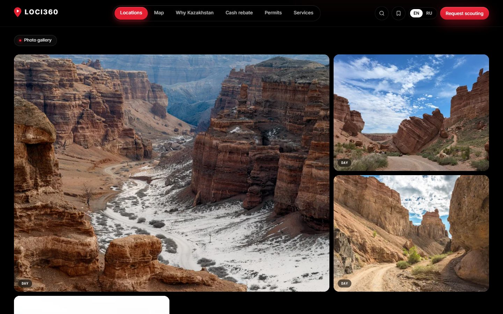
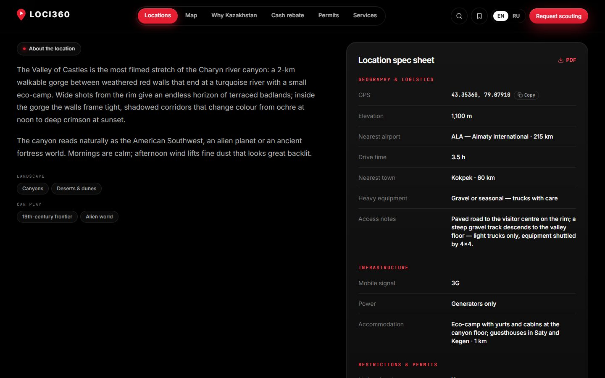

# LOCI360

**Каталог и карта кинолокаций Казахстана для иностранных продюсеров.** У каждой локации есть 4K-шоурил, фото по времени суток, панорамы 360°, технический паспорт в PDF и кнопка «Запросить скаутинг». Команда кинокомиссии ведёт всё это в CMS на русском, без программиста.

Сайт на английском (основной) и русском · 46 локаций в 7 кластерах · Next.js 16 · NestJS 11 · PostgreSQL · FFmpeg



| | |
|---|---|
|  |  |
| **Карта.** Все локации с кластерами, граница Казахстана, фильтры слева | **Страница локации.** Обложка, жанры, ключевые цифры, PDF и заявка |
|  |  |
| **Галерея.** Фото с пометками «день / золотой час / ночь», просмотр с примеркой цветокоррекции | **Техпаспорт.** Логистика, связь, электричество, проживание, разрешения |

---

## Запуск

Нужны **Node.js 22+** и **Docker Desktop**.

```bash
git clone https://github.com/tutto-passa6767/loci360.git
cd loci360
npm start
```

На Windows можно просто дважды кликнуть **`start.cmd`**: когда всё будет готово, сайт откроется в браузере.

`npm start` делает всё сам:

1. включает Docker Desktop, если он выключен (например, после перезагрузки);
2. ставит зависимости (заново — только если изменился `package-lock.json`, например после `git pull`);
3. при первом запуске создаёт `.env` со случайными паролями, заполняет базу и создаёт администратора CMS. Логин и пароль появятся в консоли и допишутся в конец `.env`;
4. поднимает PostgreSQL, MinIO, Mailpit и обработчик медиа, применяет миграции;
5. запускает API и сайт и следит за ними: если что-то упало или 1,5 минуты не отвечает, перезапускает само.

Остановить: **Ctrl+C** (контейнеры продолжат работать) или **`npm run stop`** (остановит всё). Данные хранятся в томах Docker и не пропадают.

| Что | Адрес |
|---|---|
| Сайт | http://localhost:3360 (русская версия — `/ru`) |
| CMS | http://localhost:3360/admin |
| API | http://localhost:4360/api |
| Письма с сайта (Mailpit) | http://localhost:58360 |
| Хранилище (консоль MinIO) | http://localhost:59361 |

Порты нарочно нестандартные, чтобы не мешать другим проектам на той же машине. База, хранилище и почта открыты только на 127.0.0.1.

> **Медиафайлы в git не хранятся.** После клонирования локации, тексты и паспорта на месте, а фото и видео нет. Загрузите свои через CMS → «Фото и видео» или наберите демо-набор скриптами (раздел [Демо-медиа](#демо-медиа)).

---

## Что умеет

### Сайт для продюсеров

- **Главная**: полноэкранное видео с жанровыми настроениями (Western, Sci-Fi, Modern City, Fantasy), поиск с быстрыми тегами, карта, кластеры, цифры «почему Казахстан», как проходит работа, FAQ, контакт менеджера и короткая форма вопроса.
- **Каталог** `/locations`: сетка, список и карта. Фильтры по жанру, ландшафту, эпохе, кластеру, сезону, подъезду для грузовиков, расстоянию от аэропорта и правилам для дронов. Сортировка; всё состояние хранится в адресе страницы, ссылкой можно поделиться.
- **Страница локации**:
  - HLS-плеер 4K / 1080p / 720p; варианты цветокоррекции одного ролика переключаются без потери позиции; B-roll под плеером;
  - галерея по времени суток с лайтбоксом и примеркой «look» (day-for-night, teal & orange, bleach, noir);
  - просмотрщик панорам 360° с гироскопом, VR и полным экраном; лицензированные панорамы 360Cities, Kuula, Matterport и Street View встраиваются по коду;
  - технический паспорт и PDF к нему, карта;
  - климат по месяцам (Open-Meteo, ERA5 2020–2024) и планировщик света: восход, золотой час, закат на любую дату;
  - похожие локации.
- **Подборка** (shortlist): сравнение локаций бок о бок, ссылка, которой можно поделиться, PDF-досье и одна заявка на все локации сразу.
- **Заявка на скаутинг**: проект, бюджет, даты, локации. Продюсер получает письмо-подтверждение, команда — уведомление, а заявка попадает в CMS.
- **Контентные страницы**: Why Kazakhstan, Cash rebate, Permits, Privacy, реестр сервисных компаний, рассылка.
- **Мелочи**: палитра команд Ctrl/⌘+K, SEO (hreflang, sitemap, Open Graph, JSON-LD), своя статистика без cookie. GA4 и Яндекс Метрика подключаются по желанию, тогда появляется баннер согласия.

### CMS для команды (`/admin`, на русском)

- **Фото и видео**: для каждой локации обложка, шоурил, доп. ролики, галерея и панорамы. Файлы перетаскиваются с компьютера. «Заменить» ставит новый файл на место старого, порядок меняется перетаскиванием, всё сохраняется сразу. Предупреждает о маленьких и вертикальных файлах.
- **Локации**: тексты на двух языках, точка на карте, технический паспорт, жанры и теги, SEO.
- **Заявки**: статусы, ответственный, заметки, экспорт в CSV; вопросы с сайта и подписчики рассылки.
- **Медиатека**: загрузка частями прямо в хранилище с докачкой после обрыва (видео до 200 ГБ), статус обработки, авторы и подписи.
- **Главная, страницы, сервисные компании, жанры и кластеры, настройки** (контакты, кому приходят заявки, SEO, FAQ, менеджер, счётчики аналитики).
- **Команда и доступ**: роли администратор и редактор, двухфакторная защита (TOTP), журнал всех действий, статистика посещений.

### Обработка медиа

Мастер-файлы идут из браузера в приватный бакет частями по подписанным ссылкам; API байты не пропускает через себя. Обработчик берёт задачи прямо из PostgreSQL (`FOR UPDATE SKIP LOCKED`, без Redis) и кладёт результат в публичный бакет под неизменяемыми ключами, так что CDN может кэшировать всё навсегда.

| Тип | Что получается |
|---|---|
| Видео | HLS 2160 / 1080 / 720 / 480 (не выше исходника) с водяным знаком LOCI360, спрайт для перемотки, 6-секундное превью для карточек, 15-секундный фон для главной, постеры |
| Фото | WebP 480 / 960 / 1600 / 2560, JPEG для печати в PDF, обрезка 1200×630 для соцсетей, размытая заглушка |
| Панорама 360° | Равнопромежуточная проекция 4096 и 8192 px плюс превью 16:9 |

---

## Как устроено

```
 Браузер ─────▶ Next.js — сайт и CMS (:3360) ──/api──▶ NestJS API (:4360) ──▶ PostgreSQL
    │                                                      │
    ├── мастер-файлы частями, по подписанным ссылкам ──────┼──────▶ MinIO / S3  loci-originals (приватный)
    └── HLS, фото, панорамы (через CDN) ◀──────────────────┼─────── MinIO / S3  loci-media (публичный)
                                                           ▼
                                 Обработчик в Docker (FFmpeg, libvips): задачи из таблицы Asset
```

| Папка | Что внутри |
|---|---|
| `apps/web` | Next.js 16, React 19, Tailwind 4, MapLibre GL + OpenFreeMap, hls.js, three.js: сайт и CMS |
| `apps/api` | NestJS 11, Prisma, PDFKit: каталог, заявки, CMS, загрузки, PDF, статистика |
| `apps/worker` | Node + FFmpeg + libvips в Docker: обработка видео, фото и панорам |
| `packages/db` | Схема Prisma, миграции, начальные данные (46 локаций с паспортами, кластеры, жанры, страницы) |
| `scripts` | `start.mjs` (запуск одной командой), демо-медиа, импорт файлов, граница Казахстана |
| `tests/e2e` | Сквозные тесты API и сайта |

## Команды

| Команда | Что делает |
|---|---|
| `npm start` / `start.cmd` | Запустить всё (см. выше) |
| `npm run stop` | Остановить API, сайт и контейнеры |
| `npm run test:e2e` | 44 сквозных теста на запущенном стеке (`LOCI_EMAIL` / `LOCI_PASSWORD` — учётка CMS без 2FA) |
| `npm run typecheck` | Проверка типов во всех пакетах |
| `npm run admin:create -- email "Имя" "пароль" ADMIN` | Создать сотрудника или сбросить ему пароль (роль `ADMIN` или `EDITOR`) |
| `npm run db:seed` | Заново залить начальные данные |
| `npm run build` | Продакшн-сборка API, обработчика и сайта |

<details>
<summary>Запуск по шагам, без <code>npm start</code></summary>

```bash
npm install
npm run env:init          # .env со случайными секретами
npm run infra:up          # PostgreSQL, MinIO, Mailpit
npm run db:deploy         # миграции
npm run db:seed           # жанры, кластеры, демо-локации, страницы
npm run admin:create -- admin@loci360.kz "Admin" "длинный-пароль" ADMIN
npm run worker:up         # обработчик медиа (Docker)
npm run dev:api           # http://localhost:4360/api
npm run dev:web           # http://localhost:3360, CMS на /admin
```

Всё в контейнерах: `docker compose --profile app up -d --build`.

</details>

## Демо-медиа

Папка `media-src/` не хранится в git. Демо-набор собирается из фото со свободными лицензиями с Wikimedia Commons: снимки подобраны вручную для каждой локации в `scripts/fetch-demo-media.mjs`, авторы указаны на сайте под каждым кадром. Плюс несколько реальных роликов (запуск с Байконура, ракетная железная дорога, таймлапс Арала) и демо-шоурилы, собранные из фото.

```bash
node scripts/fetch-demo-media.mjs
node scripts/fetch-demo-videos.mjs
node scripts/make-demo-reels.mjs
LOCI_PASSWORD=... node scripts/import-media.mjs media-src/manifest.json --replace

node scripts/fetch-demo-panoramas.mjs                                  # панорамы 360° — после фото
LOCI_PASSWORD=... node scripts/import-media.mjs media-src/panoramas.json
```

- На сайте ничего не повторяется: демо-шоурил режется из 1–3 фото, которые потом убираются из галереи; обложка показывается только в шапке; у каждого кластера своя картинка. Это проверяет e2e-тест.
- `--replace` заменяет медиа у локаций из манифеста на манифестные. Если сотрудники уже меняли фото и видео в CMS, не запускайте его с `--replace` для этих локаций, иначе их правки пропадут.
- `scripts/import-media.mjs` загружает через API любую папку файлов, поэтому подходит и для настоящих мастер-файлов заказчика.

## Перед выкладкой в интернет

- [ ] Свой домен и HTTPS; `NEXT_PUBLIC_SITE_URL` и `APP_URL` — на публичный адрес, `COOKIE_SECURE=true`.
- [ ] CDN (Cloudflare или CloudFront) перед бакетом `loci-media`, `MEDIA_PUBLIC_URL` — на его домен. Обработанные файлы не меняются, их можно кэшировать навсегда.
- [ ] Настоящий SMTP для писем.
- [ ] Новые пароли администраторов и включённая 2FA. Демо-учётку из тестов не использовать.
- [ ] Резервные копии PostgreSQL и бакетов, мониторинг ошибок.
- [ ] Карта работает на OpenFreeMap (бесплатно, без ключа); подойдёт любой стиль MapLibre через `NEXT_PUBLIC_MAP_STYLE_URL`.

## Ещё не сделано

Это решения заказчика:

- казахская версия сайта;
- продакшн-хостинг (домен, CDN, почта, бэкапы);
- личные кабинеты продюсеров;
- онлайн-подача заявок на разрешения;
- настоящие счётчики аналитики;
- лицензии на панорамы 360Cities (список в [`docs/360-panoramas-to-license.md`](docs/360-panoramas-to-license.md)).

Условия кэшбэка (до 30%) на сайте даны как «по запросу»: программа действовала в 2019–2025 годах, текущий статус нужно подтвердить. Записи в реестре сервисных компаний — демо.

## Авторы фото на скриншотах

Wikimedia Commons:

- **Чарын**: Bgag (CC0); Maria Simonova, EkaterinaK42, Marat Rysbekov, Elana Lyssenko, Екатерина Борисова (CC BY-SA 4.0);
- **Бозжыра**: Максат79 (CC BY-SA 4.0);
- **Кольсай**: Marat Rysbekov (CC BY-SA 4.0).

Карта: © OpenStreetMap contributors, OpenFreeMap. Граница Казахстана: Natural Earth (public domain).
